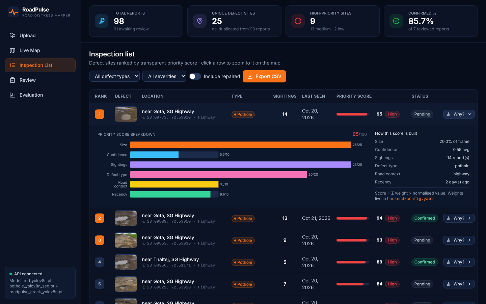
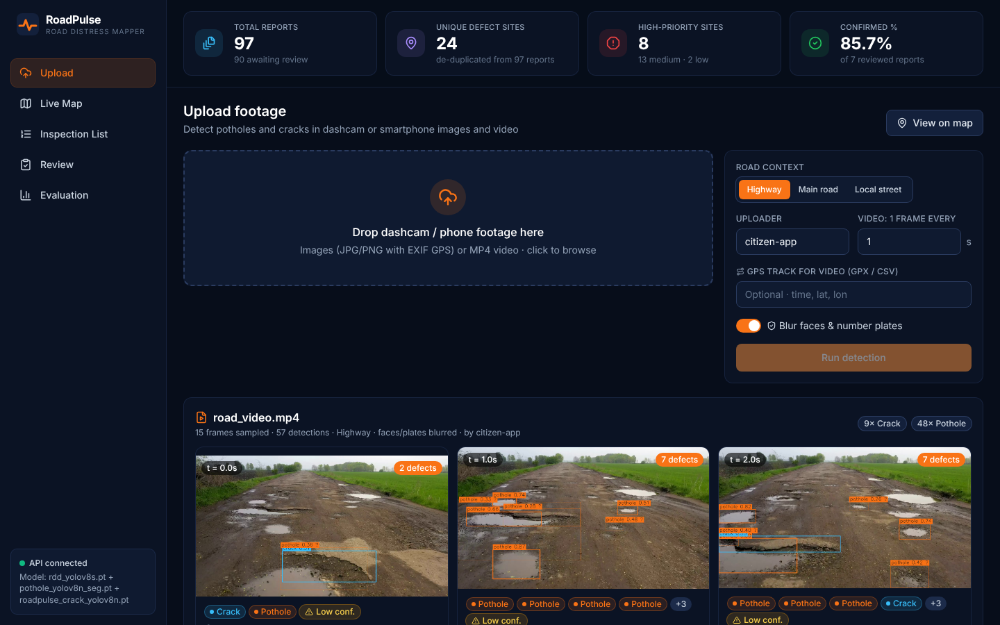
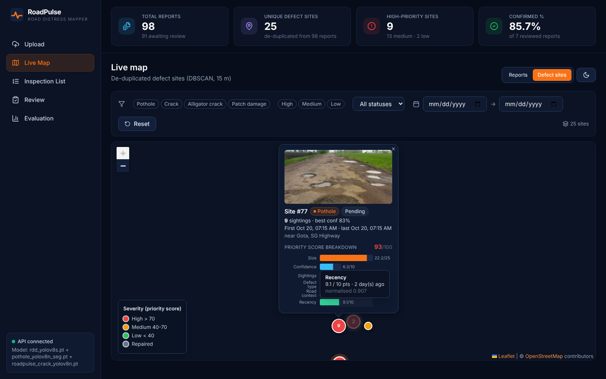
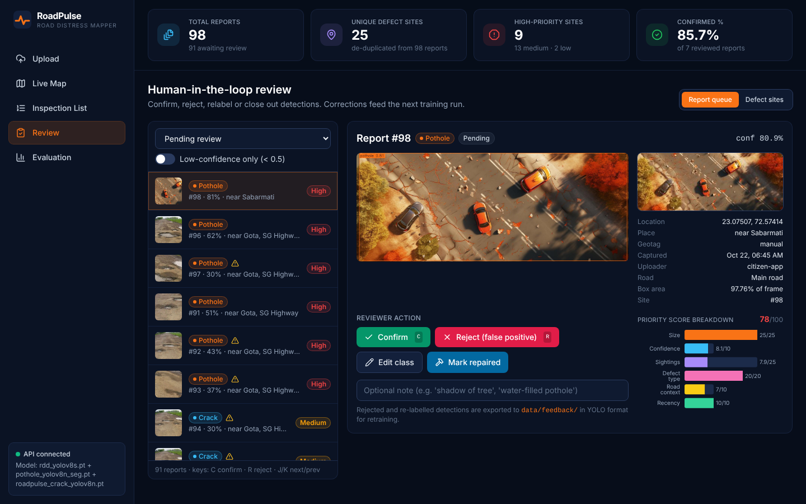
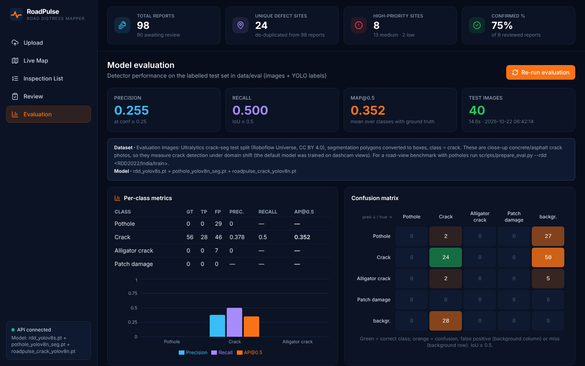
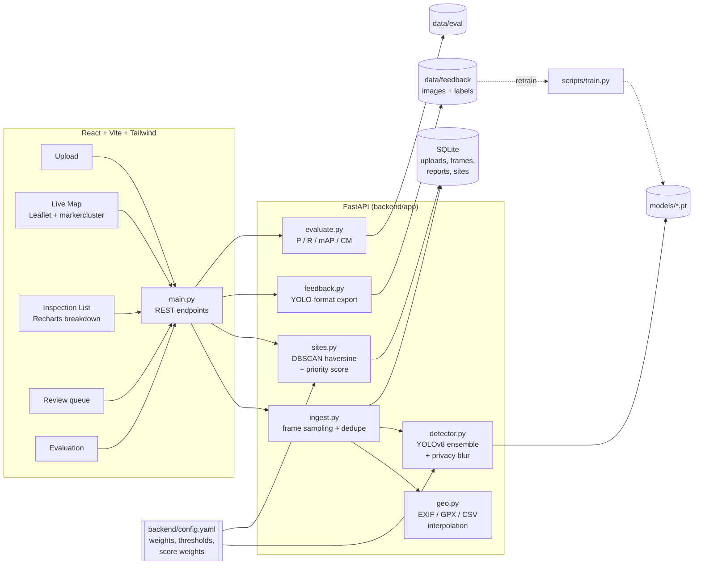

# RoadPulse: AI-powered smart pothole & road distress mapper

RoadPulse turns crowdsourced dashcam and smartphone footage into a ranked, de-duplicated list of road
defects that inspectors can trust:

1. **Detect.** YOLOv8 finds potholes, cracks and alligator cracks in images and in frames sampled from video.
2. **Locate.** GPS and time come from EXIF, a GPX/CSV track (interpolated per frame), or a pin dropped on the map.
3. **Consolidate.** DBSCAN (haversine, 15 m, same class) merges repeat reports into a single *Defect Site*.
4. **Prioritise.** A transparent 0–100 score, always shown with its per-component breakdown.
5. **Human in the loop.** Reviewers confirm, reject, relabel or close out detections. Corrections are exported as YOLO labels for retraining.



| Upload & detect | Live map (zoom-to-site + score breakdown) |
|---|---|
|  |  |
| **Review** | **Evaluation** |
|  |  |

<sub>The screenshots were captured in a sandbox with no internet access to tile servers, so the map has no basemap.
On a normal machine the OpenStreetMap tiles render under the markers (dark-filtered by default; use the moon button to switch).</sub>

---

## Quick start

Prerequisites: **Python 3.11+**, **Node 18+**. A GPU is not required; everything runs on CPU.

```bash
# 1. Backend: install once
python -m venv .venv && source .venv/bin/activate      # Windows: .venv\Scripts\activate
pip install -r requirements.txt
#   (CPU-only? install the smaller torch wheel first:
#    pip install torch torchvision --index-url https://download.pytorch.org/whl/cpu)

# 2. Backend: run (seeds ~40 demo reports on first start, then serves :8000)
./run_backend.sh            # or: python scripts/seed.py && cd backend && uvicorn app.main:app --port 8000

# 3. Frontend: run in a second terminal (http://localhost:5173)
./run_frontend.sh           # or: cd frontend && npm install && npm run dev
```

Open **http://localhost:5173**. The API docs (Swagger) are at **http://localhost:8000/docs**.

The model weights are already in `models/` (see [Model weights](#model-weights)), and a labelled
evaluation set is in `data/eval/`. Neither needs a download.

### Share it as a website (one public link)

In production a single server serves the whole site: the dashboard at `/`, the API under `/api/...`, and images
under `/media`. The `Dockerfile` builds both halves into one container listening on port 7860.

**Hugging Face Spaces (free, recommended):**
1. Create a new Space at https://huggingface.co/new-space and choose **Docker** with the *Blank* template.
2. Push this folder to the Space's git repo. The `.pt` model files are over 10 MB, so enable Git LFS first:
   ```bash
   git lfs install && git lfs track "*.pt" "*.mp4"
   git add . && git commit -m "RoadPulse" && git push
   ```
3. Add `app_port: 7860` to the Space's README front-matter. After the build (about 10 min) you get a link like
   `https://<user>-roadpulse.hf.space` that anyone can open.

**Render / Railway / any Docker host:** point the host at this repo and let it use the `Dockerfile`. They set `PORT`
automatically. Use at least 2 GB of RAM.

**Fastest temporary link from your laptop:** run the single-site server and tunnel it:
```bash
cd frontend && npm run build && cd ../backend
uvicorn app.main:asgi --port 8000          # whole site on http://localhost:8000
npx localtunnel --port 8000                # or: cloudflared tunnel --url http://localhost:8000
```

Note: free hosts usually wipe the disk on restart. The demo data re-seeds itself, but uploads and reviews made on
the hosted copy don't survive a restart.

### 2-minute demo script

1. **Upload**: drop `sample_data/road_video.mp4` plus `sample_data/road_video_track.gpx` (GPS track),
   pick *Highway*, then press **Run detection**. You get 15 sampled frames with labelled boxes, each one geotagged by
   interpolating the GPX track.
2. Drop `sample_data/no_gps_pothole_closeup.jpg`. It has no GPS, so a map appears. **Click where it was
   taken** and press **Confirm location**.
3. **Live Map**: colour-coded clusters (green/amber/red). Click a marker to see its thumbnail, class, confidence, time and the
   score breakdown chart. Switch to **Defect sites** to see the de-duplicated view, and try the filters.
4. **Inspection List**: sites ranked by score. Click **Why?** to see the breakdown, click a row to fly to it on the
   map, and use **Export CSV** for the work order.
5. **Review**: work the queue with **C** (confirm), **R** (reject) or *Edit class*. Low-confidence items carry a
   warning badge. Rejections and relabels land in `data/feedback/` as YOLO labels.
6. **Evaluation**: precision, recall, mAP@0.5, the confusion matrix and sample true/false positives.

To reset the demo, run `python scripts/seed.py --reset`.

---

## Architecture



**Pipeline for one upload:** save file → (video) sample 1 frame every *N* s, skipping near-identical frames
(mean abs diff of a 64×64 grey thumbnail < threshold) → YOLOv8 on the **unblurred** frame (so blur never hides
damage) → blur faces and plates → save the clean and annotated JPEGs and a crop per detection → one **Report** per
detection → re-cluster all Reports into **Sites** → re-score.

---

## How the priority score is computed

Every component is first **normalised to 0–1**, then multiplied by its weight. The weights sum to 100, so
the score is a plain sum and the bar chart always adds up. All numbers live in `backend/config.yaml`.

| Component | Weight | Normalised value (0–1) |
|---|---:|---|
| **Size** | 25 | largest `bbox_area / frame_area` in the site ÷ `size_full_at` (0.12), capped at 1 |
| **Confidence** | 10 | mean model confidence of the site's reports |
| **Sightings** | 25 | `log(1+n) / log(1+8)`, n = unique reports in the cluster (1 → 0.32, 3 → 0.63, 8+ → 1) |
| **Defect type** | 20 | pothole 1.0 · alligator crack 0.7 · patch damage 0.45 · crack 0.3 |
| **Road context** | 10 | highway 1.0 · main road 0.7 · local street 0.3 (chosen at upload) |
| **Recency** | 10 | `0.5 ^ (days since last sighting / 14)` |

```
score = Σ weight_k × normalised_k                      (0 … 100)
severity = High if score > 70, Medium if 40 ≤ score ≤ 70, Low if score < 40
```

Repaired sites drop to 0 and leave the ranking (toggle *Include repaired* to see them). When a site has a
mix of repaired and open reports, only the open ones are scored.

**Duplicate grouping.** For each defect class, DBSCAN runs with `metric="haversine"`, `eps = 15 m`, and
`min_samples = 1`. DBSCAN *chains*: frames 10 m apart along a badly damaged road would become one 200 m "site".
To prevent that, any cluster wider than `max_span_m` (30 m) is split with complete-linkage agglomerative
clustering, which guarantees a maximum diameter. A site's id is the smallest report id in it, so ids stay
stable as new sightings arrive. Each site keeps its sighting count, first and last seen dates, and its best image
(confirmed first, then the highest confidence × size).

---

## Model weights

`backend/config.yaml → model.weights` takes one path or a list. A list runs as an **ensemble**, and
same-class boxes are merged with NMS (IoU 0.5). You can also override it with `ROADPULSE_WEIGHTS=a.pt,b.pt`.

| File | What | Source / licence |
|---|---|---|
| `models/rdd_yolov8s.pt` | YOLOv8s trained on **RDD2022 Japan + India**: longitudinal/transverse crack → `crack`, alligator crack, pothole | [oracl4/RoadDamageDetection](https://github.com/oracl4/RoadDamageDetection). The repo has **no licence file**, so ask the author before redistributing. |
| `models/pothole_yolov8n_seg.pt` | YOLOv8n-seg pothole specialist (boxes used) | [FarzadNekouee/YOLOv8_Pothole_Segmentation_Road_Damage_Assessment](https://github.com/FarzadNekouee/YOLOv8_Pothole_Segmentation_Road_Damage_Assessment), MIT |
| `models/roadpulse_crack_yolov8n.pt` | **Our** YOLOv8n fine-tuned with `scripts/train.py --crack-seg` (1,500 train images, 6 epochs, 416 px, CPU, about 25 min). Val mAP@0.5 = 0.72 (crack-seg val, 200 images); training curves are in `docs/crack_training_curves.png` | trained here on Ultralytics crack-seg (Roboflow, CC BY 4.0) |
| `models/yolov8n.pt` | COCO YOLOv8n, used only to find people and vehicles for privacy blur, and as the base for `train.py` | Ultralytics, AGPL-3.0 |

Model class names are mapped to the four canonical classes by substring (`model.class_map` in the config).
None of the bundled models predicts `patch_damage`; the class exists so reviewers can relabel into it and
so a model trained on such data drops straight in.

### Fine-tuning (`scripts/train.py`)

```bash
# Roboflow Universe dataset (YOLOv8 export). Needs: pip install roboflow; export ROBOFLOW_API_KEY=...
python scripts/train.py --roboflow <workspace>/<project>/<version> --epochs 50

# Any local YOLO dataset, plus the reviewer feedback collected by the app
python scripts/train.py --data ~/datasets/road-damage/data.yaml --feedback --epochs 80 --device 0

# What we ran for the bundled crack model (CPU, ~25 min)
python scripts/train.py --crack-seg --limit 1500 --epochs 6 --imgsz 416 --device cpu --name roadpulse_crack_yolov8n
```

Every source is rewritten into `datasets/roadpulse/` with labels remapped to
`0 pothole, 1 crack, 2 alligator_crack, 3 patch_damage`. Names are matched by substring, and RDD codes
D00/D10/D20/D40 are understood too. Segmentation polygons are converted to boxes. The best weights are
copied to `models/<name>.pt`; add that path to `model.weights` to use it.

---

## Feature notes

**Geotagging.** The order of precedence is EXIF GPS → GPS track → manual pin. Tracks can be GPX or a CSV with
`time,lat,lon` columns (ISO times, or seconds from the start). A video's first frame is aligned to the track
start unless you pass `video_start`, and each sampled frame's time is interpolated linearly between track
points. Uploads with no location are kept, and the UI asks you to click the map
(`POST /uploads/{id}/location`).

**Privacy.** Detection always runs on the original frame; only the *saved* frames are blurred. If
`models/yolov8n.pt` is present, people and vehicles are found first. Then the head region and any Haar
frontal face inside each person are blurred, and Haar plate detections are searched only inside vehicles,
which avoids false "plates" on road texture. Without the COCO model the Haar cascades run on the whole frame.
The blur is a toggle on the Upload page. It's a best-effort prototype blur, not a compliance guarantee.

**Human in the loop.** `POST /review/{report_id}` takes the actions `confirm`, `reject`, `edit_class` (with
`new_class`), `repaired` and `reset`. `POST /sites/{id}/review` applies one action to every report in a site.
On reject or relabel, the frame is written to `data/feedback/images/frame_<id>.jpg`, with
`labels/frame_<id>.txt` containing every **non-rejected** box in that frame (corrected classes). If the only
box was rejected, the label file is empty, which makes the frame a hard negative. `data/feedback/log.jsonl`
keeps an audit trail. *Demo-seed frames are logged but not exported*, because each one shows other, unlabelled
defects that would wrongly become background. Detections under 0.5 confidence get a warning badge that
explains lighting, rain, camera-angle and road-marking effects.

**Evaluation.** `GET /evaluate` (cached; `?refresh=true` re-runs) matches predictions to ground truth at IoU ≥ 0.5.
Precision and recall are reported at the configured confidence threshold. AP@0.5 is all-point
interpolated per class, and mAP is averaged over the classes that have ground truth. The confusion matrix
includes a *background* row/column for false positives and misses.
Build or replace the eval set with `scripts/prepare_eval.py`:

```bash
python scripts/prepare_eval.py --crack-seg --limit 40                        # default (bundled)
python scripts/prepare_eval.py --rdd ~/RDD2022/India/train --limit 100       # Indian road images, all classes
python scripts/prepare_eval.py --yolo ~/potholes/test --names pothole        # e.g. a Roboflow pothole export
```

> **Read the numbers honestly.** The bundled eval set is 40 held-out images from the crack-seg *test*
> split: close-up crack photos, class `crack` only. It says **nothing about pothole accuracy**.
> Current results with the 3-model ensemble: crack precision 0.38, recall 0.50, AP@0.5 0.35. The fine-tuned crack
> model alone scores the same mAP (0.35). Before fine-tuning, the two road models alone scored **0.02**, because of
> domain shift. The 29 "pothole" and 7 "alligator" false positives come from those dashcam-trained models firing on
> concrete texture, which is why the overall precision is 0.26. For a pothole and road-view benchmark,
> download RDD2022 India (Pascal VOC) from the
> [sekilab/RoadDamageDetector](https://github.com/sekilab/RoadDamageDetector) README and run the `--rdd` command
> above. That download wasn't possible in the build environment.

**Demo data.** `scripts/seed.py` creates about 40 reports in clusters at real Ahmedabad locations (Gota and Thaltej on
SG Highway, Visat Circle, Chandkheda, Motera and others). The images, boxes, classes and confidences come from **real model
detections** on `sample_data/`. The locations, times, uploaders and review statuses are synthetic.

`sample_data/` contains:
- `road_video.mp4`: a 15 s pothole-road clip (from the FarzadNekouee repo, MIT), plus `road_video_track.gpx` and `.csv`
  tracks placed on SG Highway near Gota.
- 5 JPGs with EXIF GPS and timestamps (Chandkheda, Gota, Thaltej, Visat).
- 2 JPGs without GPS, to exercise manual pinning.
- 3 crack close-ups (crack-seg test split, not in the eval set).

---

## API

| Method & path | Purpose |
|---|---|
| `POST /upload` | multipart: `files[]` (jpg/png/mp4), optional `gps_track` (gpx/csv), `uploader`, `road_context` (highway/main_road/local_street), `blur`, `sample_every`, `lat`/`lon`, `video_start` |
| `GET /reports` | filters: `defect_class`, `severity`, `status` (comma lists), `date_from`, `date_to`, `located`, `site_id`, `low_confidence` |
| `GET /sites` · `GET /sites/{id}` | de-duplicated sites; the detail view includes all of the site's reports |
| `POST /review/{report_id}` | `{action, new_class?, reviewer?, note?}` |
| `POST /sites/{id}/review` | the same action applied to every report in the site |
| `GET /ranking` · `GET /ranking.csv` | sites by score (`include_repaired`, `defect_class`, `severity`); the CSV adds per-component points and a Google Maps link |
| `GET /evaluate` | metrics on `data/eval` (`refresh=true` to recompute) |
| `GET /stats` | dashboard counters |
| `GET /uploads` · `GET /uploads/{id}` · `POST /uploads/{id}/location` · `POST /frames/{id}/location` | upload gallery and manual geotagging |
| `GET /config` | scoring weights and thresholds (used by the UI) |
| `GET /media/...` | stored frames, crops, eval samples |

---

## Project structure

```
roadpulse/
├── backend/
│   ├── config.yaml          # ALL tunables: weights paths, thresholds, DBSCAN, score weights
│   └── app/
│       ├── main.py          # FastAPI routes
│       ├── ingest.py        # upload → frames → detections → reports
│       ├── detector.py      # YOLOv8 ensemble, annotation, privacy blur, video sampling
│       ├── geo.py           # EXIF, GPX/CSV tracks, interpolation, haversine
│       ├── sites.py         # DBSCAN de-duplication + priority score
│       ├── feedback.py      # YOLO-format export of reviewer corrections
│       ├── evaluate.py      # precision / recall / mAP@0.5 / confusion matrix
│       ├── db.py            # SQLAlchemy models (SQLite)
│       └── config.py        # paths + config loader
├── frontend/                # React + Vite + Tailwind + Leaflet + Recharts
│   └── src/{pages,components,lib}
├── models/                  # YOLO weights (see table above)
├── data/
│   ├── eval/                # labelled test set (images/ + labels/)
│   ├── feedback/            # reviewer corrections (YOLO format)   [generated]
│   ├── frames/ uploads/     # stored media                         [generated]
│   └── roadpulse.db         # SQLite                               [generated]
├── sample_data/             # demo images, video, GPS tracks
├── scripts/
│   ├── seed.py              # demo data around Ahmedabad
│   ├── train.py             # fine-tune YOLOv8n (Roboflow / local / crack-seg / feedback)
│   └── prepare_eval.py      # build data/eval from crack-seg / RDD2022 / any YOLO set
├── docs/screenshots/
├── requirements.txt
├── run_backend.sh
└── run_frontend.sh
```

## Known limitations

- **Location is the camera's, not the defect's.** A pothole seen 10 m ahead is geotagged where the car was.
  The 15 m clustering radius absorbs most of this.
- **Sightings count reports, not distinct vehicles.** Several boxes in one frame at one spot all count. Counting
  unique uploads would resist a single uploader inflating a score, at the cost of fewer signals.
- **Size is approximate.** Bbox area ratio depends on camera height and distance; there is no depth or metric
  calibration.
- **EXIF timestamps are naive local time and GPX times are UTC.** Both are stored as-is; align your clocks if you
  combine them.
- **Video processing is synchronous**, at roughly 0.3–0.6 s per frame on CPU. Long clips should move to a background
  queue (and `max_frames` caps them at 120).
- **Privacy blur relies on Haar cascades**, which miss angled faces and non-standard plates.
